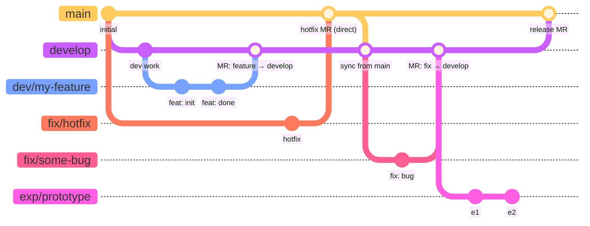

# Contributing

## Branching Strategy

### Persistent Branches
- `main` — production-ready code
- `develop` — integration branch for ongoing work

### Topic Branches
- `dev/<feature>` — feature branches (e.g., `dev/fix-convergence`)
- `fix/<issue>` — bug fixes
- `exp/<name>` — experimental / throwaway work

All merges into `main` must be peer reviewed via a GitLab Merge Request (or GitHub Pull Request).
Topic branch work is normally merged into `develop` first; direct merges to
`main` require explicit sign-off from the lead developer.
Case-specific work may be done directly on `develop` with lead-developer
approval.

### Branching Strategy Diagram

> **Note on diagram format**: Standard Markdown cannot embed draw.io (`.drawio`)
> files. The diagram below uses [Mermaid](https://mermaid.js.org/), which
> renders natively on GitLab, GitHub, and VS Code (with the Mermaid extension).

**Key rules encoded in the diagram:**

| Branch | Created from | Merges into | Requires MR? |
|---|---|---|---|
| `develop` | `main` | `main` | Yes |
| `dev/<feature>` | `develop` or `main` | `develop` or `main`* | Yes |
| `fix/<issue>` | `develop` or `main` | `develop` or `main`* | Yes |
| `exp/<name>` | anywhere | typically abandoned | — |

\* Direct merge to `main` requires lead-developer approval.
